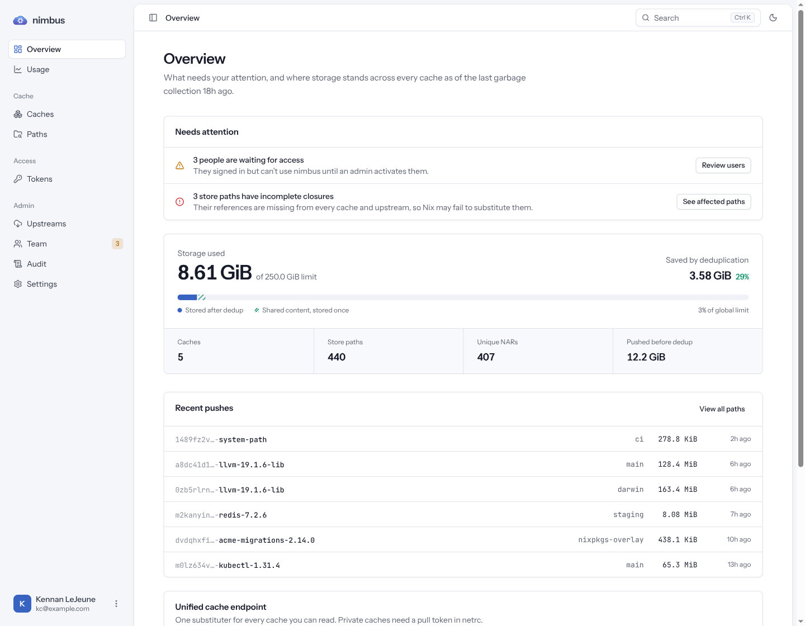
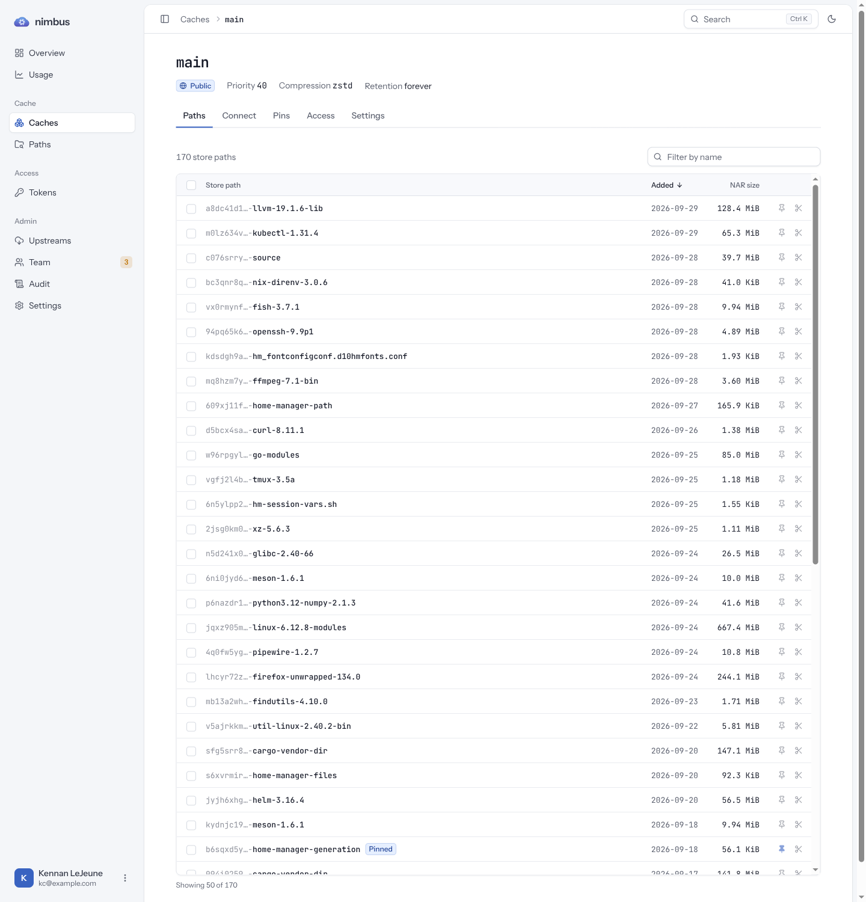
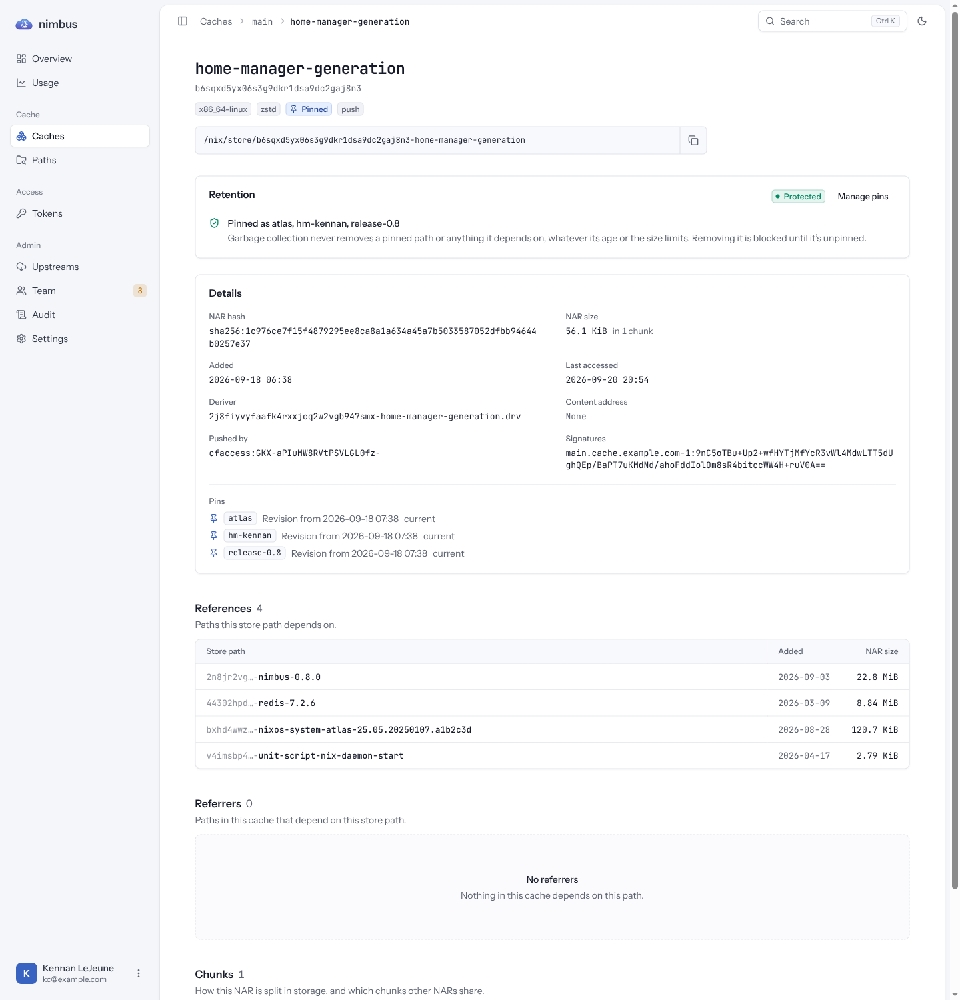
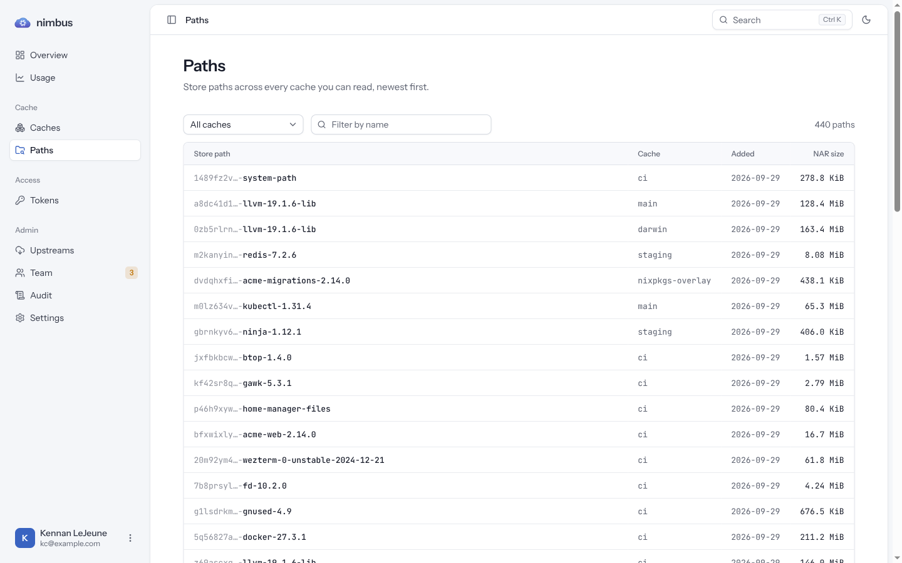
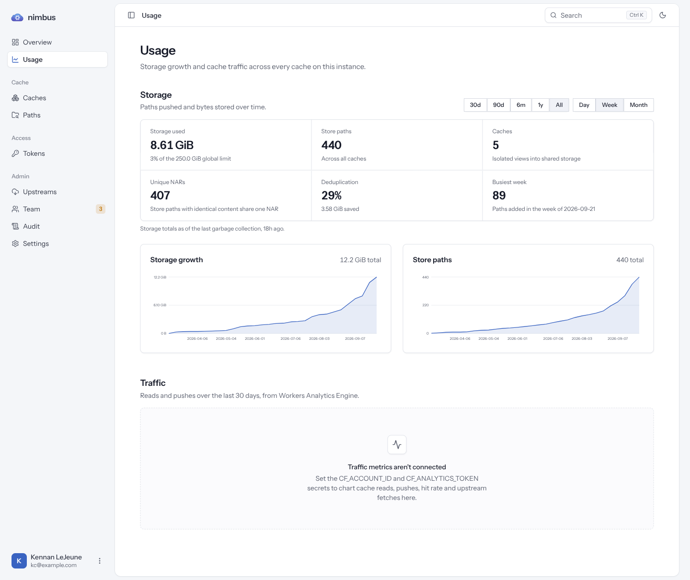
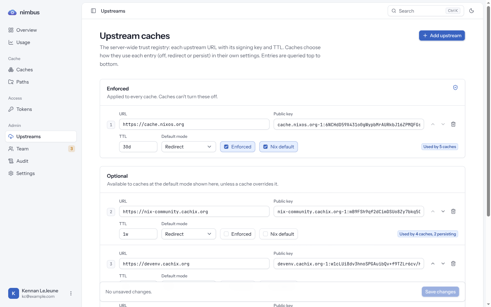

# nimbus

nimbus is a serverless, self-hostable Nix binary cache. A Cloudflare Worker
backed by D1 and R2 serves deduplicated caches with closure-aware garbage
collection and a web dashboard, with no server to run and no idle cost. It
speaks [attic](https://github.com/zhaofengli/attic)'s protocol, so the stock
`attic` client works against it ([details](#nimbus-and-attic)).

```bash
# install the CLI
nix profile install github:kclejeune/nimbus   # or: go install github.com/kclejeune/nimbus/cmd/nimbus@latest

# point it at a nimbus deployment
nimbus login prod https://cache.example.com   # browser locally, device code over SSH

# create a cache, push closures, pull from it
nimbus cache create mycache --public
nimbus push mycache ./result
nimbus use mycache                            # wires up nix.conf (+ netrc if private)
```

The server is a single Worker, deployed with `cd web && npm run deploy` (see
[Deploy](#deploy)). [CLI](#cli) covers the full command set.



## Motivation

Running a Nix cache shouldn't require running a machine. The established
self-hosted options assume a long-lived server, a relational database, and
object storage, all provisioned, patched, and paid for while they sit idle
between CI runs. nimbus implements the same protocol on pay-per-request
primitives: a Worker for compute, D1 (SQLite) for metadata, and R2 for NAR and
chunk storage. R2 has no egress fees, which matters for a binary cache. The
storage and database layers are thin (a portable SQLite schema and a flat
object layout), but Cloudflare is the only supported target today.

## Features

- **Attic-compatible protocol.** The binary-cache surface (`nix-cache-info`,
  narinfo, NARs, server-managed Ed25519 signing) and the `/_api/v1` API
  (get-missing-paths, upload-path, cache-config), extended with endpoints for
  cache rename, pins, path removal, server GC, and chunked uploads.
- **Multi-tenant caches, global dedup.** Public and private caches share one
  content-addressed store. NARs dedup whole, and NARs of 8 MiB or more are cut
  into FastCDC chunks that dedup individually across caches. The nimbus CLI
  chunks large NARs itself and uploads only the chunks the server lacks.
- **Access control.** Per-user and per-group grants in attic's permission-bit
  vocabulary over cache names or globs (`ci-*`), managed per subject or per
  cache. OIDC group claims sync into local groups. Cache creators get full
  control of what they create, grants follow renames, and a token can never
  exceed its issuer's effective grants. New accounts wait for an admin, or
  for membership in `OIDC_ACTIVATION_GROUP`.
- **Unified cache endpoint.** The cache host's root is a substituter over
  every cache the requester can read: public caches plus private ones the
  bearer token can pull, in priority order, re-signed with one proxy key.
  Upstream narinfos are verified against their registered keys and also signed
  with the proxy key, including paths that cannot be persisted. One
  `substituters` entry and one `trusted-public-keys` entry cover them all.
- **Server-side compression.** Per-cache zstd (WASM), gzip, or none; brotli
  and xz NARs from older imports stay readable.
- **Upstream registry.** Admins manage trusted upstreams (URL, public key,
  TTL) in one registry. Each cache subscribes to each upstream as off,
  redirect, or persist, and enforced upstreams apply to every cache.
  `get-missing-paths` filters out paths an upstream already serves (with
  cached verdicts). Reads of those paths serve the narinfo and redirect NARs
  to the upstream; persist mode also ingests them in the background. Ingestion
  supports zstd or uncompressed NARs up to 16 MiB compressed and uncompressed;
  other paths remain available from the upstream and are included in the next
  client push. Per-cache endpoints retain upstream signatures until ingestion;
  the unified endpoint also signs them with the proxy key. Every cache and
  upstream offers a generated `nix.conf` snippet.
- **Closure-aware GC.** Retention keeps the full closures of recently used
  paths and pins, so GC never leaves a broken closure. Per-cache age and size
  budgets, a global storage ceiling, eviction after pushes that exceed a
  budget, abandoned-upload reaping, and a nightly run. Removing a path keeps
  its dependencies while other paths still need them. Pins are either single
  paths or cachix-style named pins with revision history
  (`--keep-revisions`, `--keep-days`).
- **Admin UI.** Caches with access lists and budget meters; store-path
  browsing and search with references, referrers, and NAR/chunk breakdowns;
  a cross-cache path explorer; pins; scoped token issuance and revocation;
  users, groups, and grants; the upstream registry; ingest and (with Analytics
  Engine) read-traffic monitoring; GC reports with closure-integrity
  warnings; and an audit log.
- **Auth.** OIDC or Cloudflare Access for the dashboard; HS256 attic JWTs
  (plus RS256 verification) for the protocol.
- **Edge-cached reads.** narinfo and NAR responses are edge-cached and purged
  by cache tag, and cache misses read from D1 replicas rather than the write
  primary.
- **Go CLI.** Browser-loopback and RFC 8628 device-code login, closure-aware
  parallel `push`, store watching, server GC, and cache and token
  administration. See [CLI](#cli).

<table>
  <tr>
    <td></td>
    <td></td>
  </tr>
  <tr>
    <td></td>
    <td></td>
  </tr>
  <tr>
    <td colspan="2"></td>
  </tr>
</table>

## nimbus and attic

nimbus is a reimplementation of attic, and the design is attic's: caches as
views into one deduplicated, content-addressed store, content-defined
chunking, and JWT-scoped permissions. What changes is the runtime underneath.
Everything below was checked against attic
[`7a19204`](https://github.com/zhaofengli/attic/commit/7a19204).

### Compatibility

The stock `attic` client and attic-minted tokens (HS256, or RS256 with the
public key) work for login, `use`, `push`, `watch-store`, and every `cache`
subcommand. The exceptions:

- NARs of 100 MiB or more exceed the Workers request-body limit. Push them
  with the nimbus CLI, which uploads them in chunks.
- Changing a cache's visibility, keypair, or upstream key names requires a
  token issued by nimbus.
- Retention is kept in whole days, so shorter periods round up to a day.
  nimbus has no global default, so attic's `Global` setting means unlimited.
- The stock client does not retry the `503` that upload admission can return
  under load.

### Differences

|                    | attic                                                                        | nimbus                                                                      |
| ------------------ | ---------------------------------------------------------------------------- | --------------------------------------------------------------------------- |
| Runs on            | any host; NixOS module, OCI images                                           | Cloudflare Workers Paid                                                     |
| Metadata / storage | PostgreSQL or SQLite; S3-compatible or local disk                            | D1; R2                                                                      |
| Chunking           | FastCDC 16/64/256 KiB, configurable                                          | FastCDC 2/8/16 MiB, fixed; chunks are not shared with an attic store        |
| Large uploads      | one streaming PUT                                                            | chunked from 64 MiB, sending only missing chunks                            |
| Compression        | server-wide zstd, brotli, xz, or none                                        | per-cache zstd, gzip, or none                                               |
| Garbage collection | per-object expiry, off by default                                            | closure-aware, by age and size, with pins                                   |
| Path removal       | none                                                                         | closure-safe `cache rm`                                                     |
| Upstream caches    | client skips paths signed by listed keys                                     | server-side registry with filtering and pull-through                        |
| Tokens             | `atticadm make-token` from the signing secret, HS256 or RS256, no revocation | issued by a signed-in user from the dashboard or CLI, HS256 only, revocable |
| Access control     | token permission bits                                                        | user and group grants over the same bits, OIDC group sync                   |
| Substituters       | one per cache                                                                | one per cache, or a single endpoint for every readable cache                |
| Admin interface    | CLI                                                                          | web dashboard and CLI                                                       |
| NAR downloads      | presigned S3 redirect for single-chunk NARs                                  | through the Worker, edge-cached                                             |

## CLI

```bash
nimbus login prod https://cache.example.com <token>    # non-interactive: paste a token
nimbus login prod https://cache.example.com --device   # force device code (--web forces browser)
nimbus cache create mycache --public --compression zstd --priority 40
nimbus cache configure mycache --retention-days 30 --retention-max-bytes 50000000000
nimbus cache configure mycache --purge-broken-after-days 7  # opt in to nightly broken-closure cleanup
nimbus use mycache                                     # wire up nix.conf (+ netrc if private)
nimbus use mycache --remove                            # undo it
nimbus push mycache ./result /nix/store/...            # closures, in parallel
nimbus push mycache --stdin < paths.txt                # paths from stdin
nimbus push mycache --no-closure --jobs 10 ...         # exact paths, more parallelism
nimbus watch-store mycache                             # push new store paths as they appear
nimbus watch-exec mycache -- nix build ...             # push what a command builds
nimbus gc --dry-run                                    # preview (or run) server GC
nimbus repair mycache                                  # plan uploads of missing closure dependencies
nimbus repair mycache --apply                          # upload dependencies still in this machine's store
nimbus purge mycache                                   # plan removal of broken paths and their dependents
nimbus purge mycache --apply                           # remove the still-broken, unprotected paths
nimbus whoami                                          # decode the configured token
nimbus wai                                             # alias for whoami
nimbus doctor mycache                                   # read-only checks with suggested fixes (alias: dr)
nimbus dr mycache --json                                # structured report for scripts
nimbus cache list                                      # caches you can see, with your access bits
nimbus cache info mycache
nimbus cache rename mycache newname
nimbus cache pin mycache /nix/store/...                # single-path pin
nimbus cache pin mycache v1.7 /nix/store/... --keep-revisions 5   # named pin with history
nimbus cache pins mycache                              # pins and their revisions
nimbus cache unpin mycache v1.7                        # a pin name (all revisions), path, or hash
nimbus cache rm mycache /nix/store/...                 # closure-safe path removal
nimbus cache destroy mycache
nimbus token create ci --cache 'ci-*' --pull --push --expiry-days 90
nimbus token list
nimbus token revoke <id>
```

### Configuration

Browser and device-code login let admins select additional cache-management
permissions, Garbage collection, and Trust admin. These are optional and
unchecked by default. For `nimbus repair`, select Pull and Push for the target
cache (or All caches); select Garbage collection as well to run `nimbus gc`
afterward. `nimbus purge` requires Pull and Delete paths. Re-running
`nimbus login NAME ENDPOINT` replaces the saved token;
`nimbus whoami` shows the resulting scope.

Caches are addressed as `[server:]cache`; the first login becomes the default
server (`--set-default` changes it later). Config lives in
`$XDG_CONFIG_HOME/nimbus/config.toml` (default `~/.config`, on macOS too); a
server's token can live in a separate file via `token_file`. CI can skip the
file: `NIMBUS_ENDPOINT` with `NIMBUS_AUTH_TOKEN` or `NIMBUS_AUTH_TOKEN_FILE`
defines a server, and `NIMBUS_DEFAULT_SERVER` or
`NIMBUS_SERVERS_<NAME>_{ENDPOINT,TOKEN,TOKEN_FILE}` override the file. Exit
codes distinguish retryable failures (75), auth (77), and config (78).

`nimbus doctor [SERVER:]CACHE` (`nimbus dr`) checks token expiry, cache discovery,
server-reported permissions, effective Nix substituters and signing keys, private
cache netrc configuration, and one page of GC-recorded closure warnings. It uses
GET requests and local inspection only; it suggests fixes rather than applying
them. It does not run GC, upload paths, purge anything, or refresh upstream
verdicts. Warnings describe the GC snapshot; use the suggested `repair` command
to verify current coverage. Local availability checks are bounded to that page.
The root proxy has a separate signing key, so doctor reports that it cannot
verify that key through per-cache discovery. Daemon trust policy and netrc
credential authorization also require separate verification.

Doctor exits 1 if it finds warnings or errors, including checks it cannot
complete. `--json` writes the report to stdout and progress to stderr;
`--timeout` sets the total check budget (default 30 seconds).

### Pushing

If Settings reports incomplete closures, run `nimbus repair mycache`
on the machines that built those paths, then `nimbus repair mycache --apply`. This
uses the reference graph from the last GC, rechecks upstream coverage, and
pushes locally available missing dependencies with their full closures. It
requires pull and push permission and a Worker with the repair endpoint.
Both commands show a plan by default; only `--apply` uploads or deletes paths.
Verification and planning show a live heartbeat on terminals and stage counters
in logs. Local store checks and purge application show progress bars when their
totals are known; repair uploads keep their per-path transfer progress. Unanswered
upstream checks are listed as **unverified**, separately from confirmed misses.
Repair can upload locally available paths from either category, and exits
nonzero when an applied repair still has unavailable dependencies. It cannot recover bytes no machine or upstream still
has: rebuild the original outputs and push their closures in that case.
The Settings warning is a snapshot and refreshes at the next nightly GC, or
after `nimbus gc` with a GC-authorized token. Upstream checks can refresh
verdict rows while planning; no NARs are uploaded without `--apply`.

`nimbus purge mycache` plans removal of obsolete outputs whose dependencies
cannot be recovered, including their cached parents and reverse dependents. Unverified
dependencies are excluded. Applying a purge re-probes cached upstream misses;
failed or incomplete checks retain the affected paths. The server revalidates pins,
recent uploads, and reviewed object versions at application time. A changed or
newly protected path is retained; healthy shared dependencies and other caches
are preserved. Metadata removal and its edge-invalidation journal commit
atomically. Edge invalidations resume automatically through the purge
coordinator if rate limited or interrupted; NAR and chunk storage is reclaimed
by later GC. A single reviewed purge group is bounded to 10,000 affected paths;
larger groups are split by missing dependency when possible.

Automatic broken-closure cleanup is disabled by default for every cache. Enable
it in cache settings or with `nimbus cache configure mycache
--purge-broken-after-days 7`; use `-1` to disable it. The delay must be 1–3650
days. Only nightly GC performs automatic cleanup; manual GC, dry runs, and
size-triggered GC do not. `nimbus cache info mycache` shows the policy.

Each confirmed missing dependency starts its own timer, regardless of how
old its parent objects are. A later nightly check must confirm absence again
after the delay. Recovered or uncertain results reset the timer, as do policy
changes and detected changes to the enabled upstream configuration. Pinned
closures remain protected; newly published/revived paths receive at least the
same delay. Automatic cleanup uses the same atomic version/pin checks and edge
invalidation journal as manual purge. Local Nix GC roots must be registered as
Nimbus pins to protect their cached closures.

Work is bounded: nightly maintenance rotates through one enabled cache per
run, checks at most 64 dependency hashes (at most 200 live upstream probes),
and removes at most 500 paths using at most four purge-plan queries. Discovery
and rechecking existing observations share that budget. Large closures that
cannot fit the budget are retained; GC logs/stats report deferrals so an
operator can review them with `nimbus purge`. Settings shows the latest cleanup
counts. No bytes are reconstructed automatically; use `nimbus repair` on a
machine that can restore them.

`push` resolves closures with `nix path-info`, skips paths the server
already has or can fetch from its upstreams (`--ignore-upstream-cache-filter`
disables the upstream check), and uploads raw NARs for the server to
compress. NARs of 64 MiB or more are instead cut with the server's FastCDC
boundaries, zstd-compressed locally, and uploaded chunk by chunk, skipping
chunks the server has. `push` accepts attic's flags (`--stdin`,
`--no-closure`, `--jobs`, `--ignore-upstream-cache-filter`), so it can replace
`attic push` in existing tooling.

`watch-exec` collects every path the command adds and pushes them as one
closure-deduplicated batch when it exits, flushing early whenever the store
is idle for `--batch-idle` (15s; `0` waits for exit). `--batch=false`
streams paths as they settle instead.

## Deploy

[](https://deploy.workers.cloudflare.com/?url=https://github.com/kclejeune/nimbus/tree/main/web)

The button clones this repo into your GitHub or GitLab account, provisions
D1 and R2, prompts for secrets, and deploys to `workers.dev`; you then add
your two hostnames
([docs/deploy.md](docs/deploy.md#one-click-deploy)). To deploy by hand:

```bash
cd web && npm run deploy   # migrate + build, then wrangler deploy; WAF rules in parallel
```

[docs/deploy.md](docs/deploy.md) is the full walkthrough: prerequisites,
configuration, resources, authentication and the first admin, secrets, WAF
rules, and overload controls.

## Development

Requires Go 1.26 and Node 24 ([mise](https://mise.jdx.dev) installs both).

```bash
mise run check        # lint (rewrites files) + go test + build CLI and web
go test ./...         # CLI tests
cd web && npm install
npm run check         # svelte-check
npm test              # vitest
npm run dev:worker    # wrangler dev on localhost:8788
```

For local development, copy `web/.dev.vars.example` to `web/.dev.vars` and
fill in the secrets. [`web/README.md`](web/README.md#development) explains
switching the local Worker between the admin UI and the cache API.

### Repository layout

```
cmd/nimbus/  Go CLI (cobra + fang)
internal/    CLI internals: config, API client, nix interop, push engine, FastCDC chunker
web/         SvelteKit admin UI and binary-cache API server, one Worker
docs/        deployment and release guides
```

The Worker serves the admin UI on the app hostname and the binary-cache API
on the cache hostname, dispatched by host in `web/worker-entry.ts`.
[`web/README.md`](web/README.md) covers the server's internals and
authorization model.
